# 📋 GROUP 4 – PROJECT SUMMARY & COMPLETION REPORT

> **Project Name:** Subscription List Management System – Functional Programming  
> **Group:** 4  
> **Workshop Dates:** 12-11-2026 to 16-11-2026  
> **Team Lead:** Anas  
> **Team Members:** Anas, Veselina, Jay, Tukue, Carl and Padma  
> **Instructors:** Elnaz and Mehrdad  
> **Prepared By:** Padma  
> **Submission Date:** 13-11-2026  
> **Repository:** [Functional Programming Workshop](https://github.com/jackaldzn-blip/functional-programming-workshop)  
> **Implementation Status:** Completed  
> **Report Status:** Approved by Team Lead upon merge of PR #21

---

# 📑 Table of Contents

1. [🎯 Executive Summary](#1--executive-summary)
2. [📌 Project Overview](#2--project-overview)
3. [🎯 Project Objectives and Scope](#3--project-objectives-and-scope)
4. [🛠️ Technologies and Tools](#4--technologies-and-tools)
5. [🏗️ Solution Design and Implementation](#5--solution-design-and-implementation)
6. [👥 Team Responsibilities and Individual Contributions](#6--team-responsibilities-and-individual-contributions)
7. [📊 Implementation and Scenario Summary](#7--implementation-and-scenario-summary)
8. [🤝 GitHub Collaboration and Pull Request Activity](#8--github-collaboration-and-pull-request-activity)
9. [🧪 Testing and Quality Assurance](#9--testing-and-quality-assurance)
10. [⚠️ Challenges and Resolutions](#10--challenges-and-resolutions)
11. [📅 Project Collaboration and Meeting Summary](#11--project-collaboration-and-meeting-summary)
12. [💡 Lessons Learned and Team Retrospective](#12--lessons-learned-and-team-retrospective)
13. [📦 Final Deliverables](#13--final-deliverables)
14. [🏁 Project Completion Status](#14--project-completion-status)
15. [🎓 Final Conclusion](#15--final-conclusion)
16. [🔗 Repository References](#16--repository-references)

---

# 1. 🎯 Executive Summary

Group 4 successfully developed a Subscription List Management System using Java functional programming concepts.

The objective of the workshop was to translate the provided UML class diagram into a working Java application while applying object-oriented programming, functional interfaces, lambda expressions, method references and the Java Stream API.

The six-member team distributed responsibilities across application modelling, data access, filtering, subscription actions, processing logic and the interactive console application.

In addition to implementing the core requirements, the team completed all six JUnit scenarios and developed an interactive console menu to demonstrate the application's functionality.

The project was developed collaboratively using GitHub, feature branches, pull requests, peer reviews and automated testing.

### 📊 Project at a Glance

| Metric | Result |
|---|---:|
| Team Members | 6 |
| Core Business Rules | 7 |
| Workshop Scenarios | 6 |
| Total Pull Requests | 22 |
| Merged Pull Requests | 18 |
| Closed Without Merge | 3 |
| Open Pull Requests | 1 |
| Automated Tests Passed | 53 |
| Failed Tests | 0 |
| Errors | 0 |
| Skipped Tests | 0 |

### 🏆 Overall Outcome

The application implementation was completed and successfully verified through GitHub Actions.

The team also collected individual JUnit test evidence, complete test-suite evidence and manual console screenshots covering the available menu options and plan selections.

This report consolidates the team's implementation activities, individual contributions, testing results, collaboration practices and lessons learned throughout the workshop.

---

# 2. 📌 Project Overview

## 2.1 Project Description

The objective of this workshop was to develop a simple Subscription List Management System based on the provided UML class diagram.

The application manages subscriber information, subscription plans and subscription status. It provides functionality to filter subscribers according to different business rules and perform subscription-related actions.

The project focuses on applying functional programming concepts in Java while maintaining clean object-oriented design and separation of responsibilities.

## 2.2 Project Scope

The application includes the following functionalities:

- Manage subscriber information.
- Define subscription plans: FREE, BASIC and PRO.
- Store and retrieve subscriber information using an in-memory DAO.
- Filter subscribers using reusable functional interfaces.
- Process subscriber collections using Java Streams.
- Extend subscription periods.
- Deactivate subscribers.
- Demonstrate the application's functionality through an interactive console application.

## 2.3 Business Rules Implemented

### 🔍 Subscriber Filtering

1. Identify active subscribers.
2. Identify subscribers with zero or one month remaining.
3. Identify active and expiring subscribers.
4. Filter subscribers by FREE, BASIC or PRO plan.
5. Identify paying subscribers (BASIC or PRO).

### ⚙️ Subscription Actions

6. Extend a subscriber's remaining subscription period.
7. Deactivate a subscriber by setting the active status to false.

---

# 3. 🎯 Project Objectives and Scope

| Objective | Description | Status |
|---|---|---|
| UML Implementation | Translate the provided UML diagram into Java classes | ✅ Completed |
| OOP Design | Implement Subscriber, Plan and SubscriberDAO | ✅ Completed |
| Functional Interfaces | Implement SubscriberFilter and SubscriberAction | ✅ Completed |
| Lambda Expressions | Apply lambda expressions and method references | ✅ Completed |
| Stream API | Process subscriber collections using Java Streams | ✅ Completed |
| Filtering Rules | Implement all five subscriber filtering rules | ✅ Completed |
| Subscription Actions | Implement extension and deactivation actions | ✅ Completed |
| Data Access | Implement save(), findAll() and findById() | ✅ Completed |
| JUnit Testing | Implement unit tests and six scenarios | ✅ Completed |
| Console Application | Develop an interactive menu-driven application | ✅ Completed |

---

# 4. 🛠️ Technologies and Tools

| Technology / Tool | Purpose |
|---|---|
| Java 25 | Application development |
| Maven | Build and dependency management |
| JUnit 5 | Unit and scenario testing |
| Git | Version control |
| GitHub | Repository hosting and collaboration |
| GitHub Actions | Automated build and test verification |
| IntelliJ IDEA | Java development and manual testing |

---

# 5. 🏗️ Solution Design and Implementation

## 5.1 Application Components

The implementation follows the provided UML design and separates responsibilities into individual components.

| Component | Responsibility | Owner |
|---|---|---|
| Subscriber | Stores subscriber information | Anas |
| Plan | Defines FREE, BASIC and PRO plans | Anas |
| SubscriberDAO | Stores and retrieves subscribers | Veselina |
| SubscriberFilter | Functional interface for filtering | Jay |
| SubscriberFilters | Provides reusable filtering rules | Jay |
| SubscriberAction | Functional interface for subscriber actions | Tukue |
| SubscriberActions | Provides extension and deactivation actions | Tukue |
| SubscriberProcessor | Processes subscriber lists using Streams | Carl |
| Main | Connects components and provides console interaction | Padma |

*Note: SubscriberFilters, SubscriberActions and Main are supporting implementation components added around the original UML responsibilities.*

## 5.2 Key Features Delivered

1. **Subscriber Management:** Subscriber information is managed using encapsulated fields, constructors, getters, setters and validation.
2. **Data Access:** SubscriberDAO provides in-memory storage and retrieval functionality.
3. **Reusable Filtering:** Functional interfaces and lambda expressions implement reusable subscriber filtering rules.
4. **Subscription Actions:** Subscription periods can be extended and subscribers can be deactivated.
5. **Stream Processing:** SubscriberProcessor applies filters and actions to subscriber collections.
6. **Interactive Console:** Main provides an interactive menu to demonstrate the application's functionality.

## 5.3 Interactive Console Menu

| Option | Functionality |
|---|---|
| 1 | Display all subscribers |
| 2 | Display active subscribers |
| 3 | Display expiring subscribers |
| 4 | Display active and expiring subscribers |
| 5 | Filter subscribers by plan |
| 6 | Display paying subscribers |
| 7 | Extend eligible subscriptions by three months |
| 8 | Deactivate expired FREE subscribers |
| 0 | Exit application |

The console application also handles invalid input, invalid plan selections, empty results and end-of-input scenarios.

---

# 6. 👥 Team Responsibilities and Individual Contributions

The project was divided into six areas of responsibility. Each member was assigned specific implementation components and associated testing activities.

## 👨‍💼 Member 1 – Anas (@jackaldzn-blip)

**Role:** Team Lead and Model Implementation

### Responsibilities and Contributions

Anas played a key role in coordinating the project and supporting the entire team. His contributions included:

- Created and set up the GitHub repository, establishing the foundation for team collaboration.
- Collaborated with all team members to develop and finalise the UML class diagram.
- Prepared individual task instructions and assigned responsibilities based on each member's interests, convenience, and availability.
- Created the Maven project structure and organised the required folder structure.
- Configured GitHub Actions to automate the Maven build and JUnit test execution.
- Created shared test data and documented the expected output for each test scenario to provide a consistent basis for implementation and verification.
- Designed the console output to establish a consistent format for displaying application results.
- Reviewed every pull request, provided comments and suggestions for improvements, and ensured that contributions aligned with the project requirements.
- Created documentation describing each member's responsibilities and the requirements to verify before starting testing.
- Prepared the project report template to ensure consistent reporting across the team.
- Created and maintained multiple project documents to guide the team throughout the implementation and testing activities.
- Supported every team member by explaining the project requirements, clarifying implementation details, and helping everyone understand their assigned responsibilities.
- Encouraged active participation and helped team members contribute effectively throughout the workshop.
- Implemented `Subscriber.java`.
- Implemented the `Plan` enum.
- Developed constructors, getters and setters.
- Added input validation for subscriber attributes.
- Implemented the `toString()` method.
- Developed `SubscriberModelTest.java`.
- Coordinated task allocation and implementation responsibilities.
- Established shared API contracts.
- Reviewed and merged pull requests.
- Resolved integration issues.
- Coordinated project documentation and team progress.

**Main implementation classes:**

- `Subscriber.java`
- `Plan.java`

**🧪 Testing evidence:**

- `SubscriberModelTest.java`
- [Subscriber model test screenshot](evidences/images/junit/sunscribermodel.png)

**🔗 Relevant pull requests:**

- [PR #1 – Subscriber model and Plan enum implementation](https://github.com/jackaldzn-blip/functional-programming-workshop/pull/1)
- [PR #2 – Console application scope and documentation](https://github.com/jackaldzn-blip/functional-programming-workshop/pull/2)
- [PR #4 – Subscriber toString() implementation and model tests](https://github.com/jackaldzn-blip/functional-programming-workshop/pull/4)
- [PR #5 – README and project documentation updates](https://github.com/jackaldzn-blip/functional-programming-workshop/pull/5)
- [PR #7 – Test package structure alignment](https://github.com/jackaldzn-blip/functional-programming-workshop/pull/7)
- [PR #9 – Model verification and team status updates](https://github.com/jackaldzn-blip/functional-programming-workshop/pull/9)
- [PR #14 – Team status and member task documentation](https://github.com/jackaldzn-blip/functional-programming-workshop/pull/14)
- [PR #15 – Member documentation corrections](https://github.com/jackaldzn-blip/functional-programming-workshop/pull/15)
- [PR #16 – README progress updates](https://github.com/jackaldzn-blip/functional-programming-workshop/pull/16)
- [PR #19 – Workshop documentation reconciliation](https://github.com/jackaldzn-blip/functional-programming-workshop/pull/19)
- [PR #20 – Model task checklist completion](https://github.com/jackaldzn-blip/functional-programming-workshop/pull/20)

## 👩‍💻 Member 2 – Veselina (@vlinakonsa-svg)

**Role:** Data Access Implementation

### Responsibilities and Contributions

- Implemented `SubscriberDAO.java`.
- Developed in-memory subscriber storage using `ArrayList`.
- Implemented `save()` to add new subscribers.
- Implemented functionality to update existing subscribers.
- Implemented `findAll()` to retrieve all subscribers.
- Implemented `findById()` to search for subscribers using their IDs.
- Used `Optional` to handle searches where a subscriber could not be found.
- Added handling for duplicate subscribers and null values.
- Ensured that subscriber insertion order was preserved.
- Developed `SubscriberDaoTest.java` to verify DAO operations.
- Tested saving, updating, retrieving, duplicate handling, insertion order and null validation.

**Main implementation class:**

- `SubscriberDAO.java`

**🧪 Testing evidence:**

- `SubscriberDaoTest.java`
- [SubscriberDAO test screenshot](evidences/images/junit/SubscriberDAO.png)

**🔗 Relevant pull request:**

- [PR #6 – SubscriberDAO implementation](https://github.com/jackaldzn-blip/functional-programming-workshop/pull/6)

## 👨‍💻 Member 3 – Jay (@JayB111)

**Role:** Functional Filters and Scenario Testing

### Responsibilities and Contributions

- Implemented the `SubscriberFilter` functional interface.
- Developed the `SubscriberFilters` class.
- Implemented reusable filtering rules for:
  - Active subscribers.
  - Subscribers with zero or one month remaining.
  - Active and expiring subscribers.
  - Subscribers by FREE, BASIC or PRO plan.
  - Paying subscribers (BASIC or PRO).
- Added null validation to the `byPlan()` method.
- Developed corresponding unit tests.
- Completed integration tests for Scenario 1 and Scenario 2 in `SubscriberProcessorTest`.
- Verified that inactive subscribers with expiring subscriptions were included where required.
- Reviewed implementation and provided feedback on test behaviour.
- Tested the integrated application.

**Main implementation classes:**

- `SubscriberFilter.java`
- `SubscriberFilters.java`

**🧪 Testing evidence:**

- Subscriber filter tests.
- [SubscriberFilters test screenshot](evidences/images/junit/SubscriberFilters.png)

**🔗 Relevant pull requests:**

- [PR #10 – SubscriberFilters implementation](https://github.com/jackaldzn-blip/functional-programming-workshop/pull/10)
- [PR #18 – Scenario 1 and Scenario 2 integration tests](https://github.com/jackaldzn-blip/functional-programming-workshop/pull/18)

## 👨‍💻 Member 4 – Tukue (@tukue)

**Role:** Subscription Actions and Scenario Testing

### Responsibilities and Contributions

- Implemented the `SubscriberAction` functional interface.
- Developed the `SubscriberActions` class.
- Implemented subscriber extension and deactivation actions.
- Added an activation enhancement.
- Added validation for positive subscription extension values.
- Developed JUnit tests for subscription actions.
- Completed integration tests for Scenario 4 and Scenario 5.
- Contributed to the `SubscriberProcessor` integration by correcting the use of `Stream.map()` with the void-returning `SubscriberAction.run()` method.
- Implemented the action execution correction using `forEach()` after collecting matching subscribers.
- Added integration tests for subscription extension and deactivation scenarios.
- Corrected test expectations for inactive subscribers.
- Suggested starting with the Main class early to support continuous compilation.
- Suggested implementing a console application to demonstrate the system.
- Explained the UML class diagram during the initial team meeting.
- Assisted Carl with completing the SubscriberProcessor implementation and testing.

**Main implementation classes:**

- `SubscriberAction.java`
- `SubscriberActions.java`

**🧪 Testing evidence:**

- Subscriber action component tests.
- [SubscriberActions test screenshot](evidences/images/junit/SubscriberActions.png)

**🔗 Relevant pull requests:**

- [PR #8 – SubscriberActions implementation](https://github.com/jackaldzn-blip/functional-programming-workshop/pull/8)
- [PR #12 – Follow-up subscription action scenario tests](https://github.com/jackaldzn-blip/functional-programming-workshop/pull/12) – Closed without merge.
- [PR #13 – Separate plan filtering scenario proposal](https://github.com/jackaldzn-blip/functional-programming-workshop/pull/13) – Closed without merge.
- [PR #22 – Individual contribution and retrospective documentation](https://github.com/jackaldzn-blip/functional-programming-workshop/pull/22) – Closed without merge.

## 👨‍💻 Member 5 – Carl (@Matojotam)

**Role:** Subscriber Processing and Scenario Testing

### Responsibilities and Contributions

- Implemented `SubscriberProcessor.java`.
- Developed subscriber list processing functionality using Java Streams.
- Integrated the filtering and action functional interfaces.
- Implemented `findSubscribers()` to retrieve matching subscribers.
- Implemented `applyToMatching()` to execute actions on matching subscribers.
- Developed `SubscriberProcessorTest.java`.
- Completed Scenario 3 testing.
- Received assistance from Tukue towards completing the processor implementation and testing.

**Main implementation class:**

- `SubscriberProcessor.java`

**🧪 Testing evidence:**

- `SubscriberProcessorTest.java`
- Complete JUnit execution screenshot: `JunitRun.png`

**🔗 Relevant pull request:**

- [PR #11 – SubscriberProcessor and action scenario tests](https://github.com/jackaldzn-blip/functional-programming-workshop/pull/11)

## 👩‍💻 Member 6 – Padma (@Padmaqaauto)

**Role:** Interactive Console, Scenario 6 and Report Coordination

### Responsibilities and Contributions

- Implemented `Main.java`.
- Developed the interactive console menu.
- Integrated the subscriber model, DAO, filters, actions and processor.
- Prepared shared sample subscriber data for application demonstration and testing.
- Implemented the menu options from 0 to 8.
- Implemented plan-based filtering through the console.
- Completed Scenario 6 testing using `PlanScenarioTest.java`.
- Added handling for invalid menu input and invalid plan selections.
- Added handling for empty results and end-of-input scenarios.
- Performed manual console acceptance checks.
- Identified the missing `toString()` override during early integration and communicated the issue to Anas.
- Participated in pull-request reviews and integration discussions.
- Suggested reviewing the UML before task allocation.
- Reviewed the `SubscriberProcessor` implementation and identified the incompatibility of using `Stream.map()` with the void-returning `SubscriberAction.run()` method.
- Suggested using `forEach(action::run)` after collecting matching subscribers and provided technical feedback through a GitHub PR review comment to improve the implementation.
- Suggested assigning clear ownership of the Main class and console application.
- Recommended consistent branch naming conventions.
- Coordinated the preparation of the project summary and completion report.
- Collected individual testing evidence and console demonstration screenshots.

**Main implementation classes:**

- `Main.java`
- `PlanScenarioTest.java`

**🧪 Testing evidence:**

- `PlanScenarioTest.java`
- [PlanScenario test screenshot](evidences/images/junit/PlanScenario.png)
- [Complete JUnit execution screenshot](evidences/images/junit/JunitRun.png)
- [Console Menu Screenshots](evidences/images/console/)

**🔗 Relevant pull requests:**

- [PR #3 – Initial Main class implementation](https://github.com/jackaldzn-blip/functional-programming-workshop/pull/3)
- [PR #17 – Interactive console implementation and Scenario 6](https://github.com/jackaldzn-blip/functional-programming-workshop/pull/17)
- [PR #21 – Padma: Project completion report updates](https://github.com/jackaldzn-blip/functional-programming-workshop/pull/21) – Open at the time of this report.

---

# 7. 📊 Implementation and Scenario Summary

The team completed all six workshop scenarios.

| Scenario | Description | Responsible Member | Status |
|---|---|---|---|
| Scenario 1 | Find active subscribers | Jay | ✅ Completed |
| Scenario 2 | Find expiring subscribers | Jay | ✅ Completed |
| Scenario 3 | Find active and expiring subscribers | Carl | ✅ Completed |
| Scenario 4 | Extend subscription periods | Tukue | ✅ Completed |
| Scenario 5 | Deactivate subscribers | Tukue | ✅ Completed |
| Scenario 6 | Filter subscribers by plan | Padma | ✅ Completed |

## 7.1 📋 Shared Sample Data

The team used the following seven subscriber records as the shared testing dataset, based on `docs/example-scenarios.md`.

| ID | Email | Plan | Active | Months Remaining |
|---:|---|---|---|---:|
| 1 | alex@example.test | FREE | true | 0 |
| 2 | blair@example.test | BASIC | true | 1 |
| 3 | casey@example.test | PRO | true | 6 |
| 4 | devon@example.test | FREE | false | 0 |
| 5 | ellis@example.test | BASIC | false | 1 |
| 6 | frankie@example.test | PRO | true | 0 |
| 7 | gray@example.test | FREE | true | 2 |

**Expected filter results:**

| Filter | Expected Subscriber IDs |
|---|---|
| Active subscribers | 1, 2, 3, 6, 7 |
| Expiring subscribers | 1, 2, 4, 5, 6 |
| Active and expiring | 1, 2, 6 |
| FREE plan | 1, 4, 7 |
| BASIC plan | 2, 5 |
| PRO plan | 3, 6 |
| Paying subscribers | 2, 3, 5, 6 |

**Expected action scenarios:**

- **Scenario 4 – Extend subscriptions:** Subscribers 2 and 6 are eligible. With the team-chosen extension of three months, subscriber 2 changes from 1 to 4 months, and subscriber 6 changes from 0 to 3 months.
- **Scenario 5 – Deactivate expired FREE subscribers:** Subscribers 1 and 4 are eligible. Subscriber 1 changes from active to inactive, while subscriber 4 remains inactive.

The expected results preserve the original input order. Fresh subscriber objects should be created for each mutation test to prevent changes from one test affecting another.

---

# 8. 🤝 GitHub Collaboration and Pull Request Activity

## 8.1 Repository Activity

The team used GitHub pull requests to coordinate development, review changes and integrate individual contributions.

| Activity | Result |
|---|---:|
| Repository | jackaldzn-blip/functional-programming-workshop |
| Total Pull Requests | 22 |
| Merged Pull Requests | 18 |
| Closed Without Merge | 3 |
| Open Pull Requests | 1 |
| Total Closed Pull Requests | 21 |
| GitHub Actions | Successful final verification |
| Automated Tests | 53 passed |

**Status clarification:** PR #12, PR #13 and PR #22 were closed without merge. PR #21 remained open at the time this report was prepared. Therefore, 18 merged + 3 closed without merge + 1 open = 22 total pull requests.

## 8.2 Pull Request Register

The following register summarizes the pull requests created during the workshop.

| PR Number | PR Description | Status |
|---|---|---|
| [#1](https://github.com/jackaldzn-blip/functional-programming-workshop/pull/1) | Subscriber model and Plan enum implementation | ✅ Merged |
| [#2](https://github.com/jackaldzn-blip/functional-programming-workshop/pull/2) | Console application scope and documentation | ✅ Merged |
| [#3](https://github.com/jackaldzn-blip/functional-programming-workshop/pull/3) | Initial Main class implementation | ✅ Merged |
| [#4](https://github.com/jackaldzn-blip/functional-programming-workshop/pull/4) | Subscriber toString() implementation and model tests | ✅ Merged |
| [#5](https://github.com/jackaldzn-blip/functional-programming-workshop/pull/5) | README and project documentation updates | ✅ Merged |
| [#6](https://github.com/jackaldzn-blip/functional-programming-workshop/pull/6) | SubscriberDAO implementation | ✅ Merged |
| [#7](https://github.com/jackaldzn-blip/functional-programming-workshop/pull/7) | Test package structure alignment | ✅ Merged |
| [#8](https://github.com/jackaldzn-blip/functional-programming-workshop/pull/8) | SubscriberActions implementation | ✅ Merged |
| [#9](https://github.com/jackaldzn-blip/functional-programming-workshop/pull/9) | Model verification and team status updates | ✅ Merged |
| [#10](https://github.com/jackaldzn-blip/functional-programming-workshop/pull/10) | SubscriberFilters implementation | ✅ Merged |
| [#11](https://github.com/jackaldzn-blip/functional-programming-workshop/pull/11) | SubscriberProcessor and action scenario tests | ✅ Merged |
| [#12](https://github.com/jackaldzn-blip/functional-programming-workshop/pull/12) | Follow-up subscription action scenario tests | ❌ Closed without merge |
| [#13](https://github.com/jackaldzn-blip/functional-programming-workshop/pull/13) | Separate plan filtering scenario proposal | ❌ Closed without merge |
| [#14](https://github.com/jackaldzn-blip/functional-programming-workshop/pull/14) | Team status and member task documentation | ✅ Merged |
| [#15](https://github.com/jackaldzn-blip/functional-programming-workshop/pull/15) | Member documentation corrections | ✅ Merged |
| [#16](https://github.com/jackaldzn-blip/functional-programming-workshop/pull/16) | README progress updates | ✅ Merged |
| [#17](https://github.com/jackaldzn-blip/functional-programming-workshop/pull/17) | Interactive console implementation and Scenario 6 | ✅ Merged |
| [#18](https://github.com/jackaldzn-blip/functional-programming-workshop/pull/18) | Scenario 1 and Scenario 2 integration tests | ✅ Merged |
| [#19](https://github.com/jackaldzn-blip/functional-programming-workshop/pull/19) | Workshop documentation reconciliation | ✅ Merged |
| [#20](https://github.com/jackaldzn-blip/functional-programming-workshop/pull/20) | Model task checklist completion | ✅ Merged |
| [#21](https://github.com/jackaldzn-blip/functional-programming-workshop/pull/21) | Padma – Project completion report updates | 🟡 Open |
| [#22](https://github.com/jackaldzn-blip/functional-programming-workshop/pull/22) | Tukue – Individual contribution and retrospective documentation | ❌ Closed without merge |

## 8.3 Collaboration Practices

The team followed these collaboration practices:

- Created individual feature branches for assigned tasks.
- Used pull requests to integrate changes.
- Encouraged all members to participate in code reviews.
- Reviewed implementation and test behaviour before merging.
- Resolved integration issues collaboratively.
- Maintained shared documentation and task ownership information.
- Used GitHub Actions to verify the integrated application.

---

# 9. 🧪 Testing and Quality Assurance

## 9.1 Final Automated Test Results

The complete automated test suite was executed to verify the integrated application.

| Metric | Result |
|---|---:|
| Total Tests | 53 |
| Passed | 53 |
| Failed | 0 |
| Errors | 0 |
| Skipped | 0 |
| Code Coverage | Not measured |

**Final test result: 100% of the executed tests passed.**

### 📸 Complete JUnit Test Execution Evidence

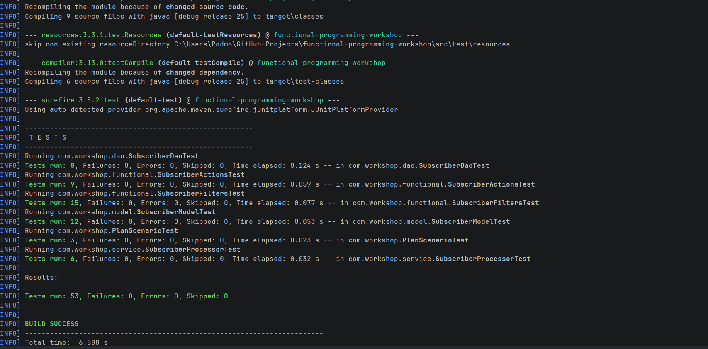

## 9.2 Individual JUnit Evidence

The following screenshots provide evidence of the individual component tests.

### 👨‍💼 Subscriber Model – Anas

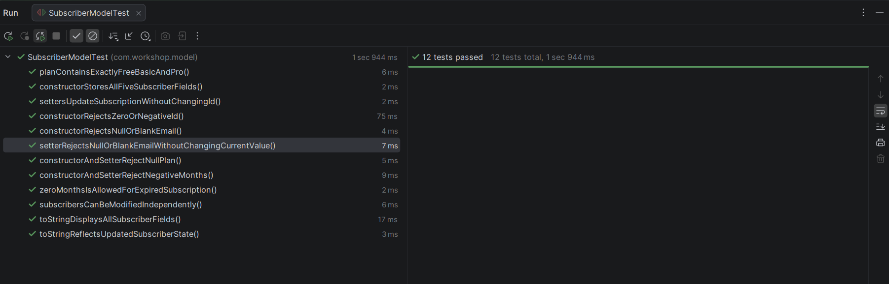

### 👩‍💻 SubscriberDAO – Veselina

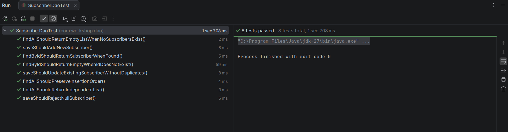

### 👨‍💻 Subscriber Filters – Jay

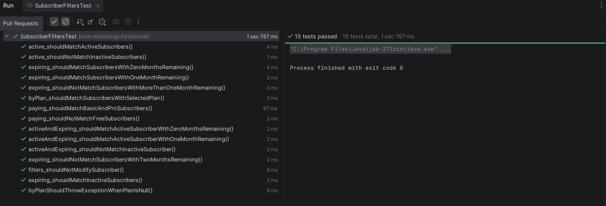

### 👨‍💻 Subscriber Actions – Tukue

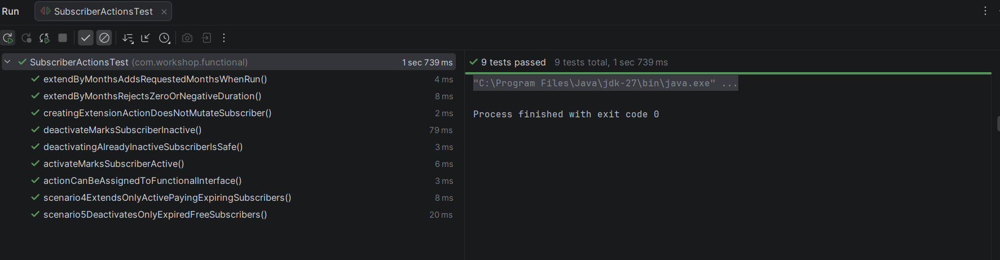

### 👨‍💻 Plan Scenario – Padma

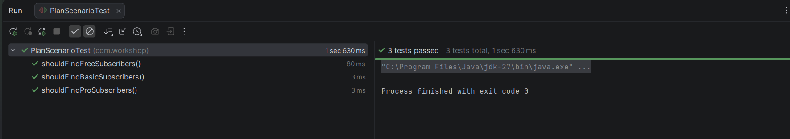

**Additional evidence:** The complete test execution screenshot records the integrated test run. Individual test classes provide evidence of the corresponding component tests.

## 9.3 Manual Console Acceptance Testing

Manual testing was performed through the interactive console application.

The following screenshots demonstrate the output for each console option.

### 💻 Option 0 – Exit Application

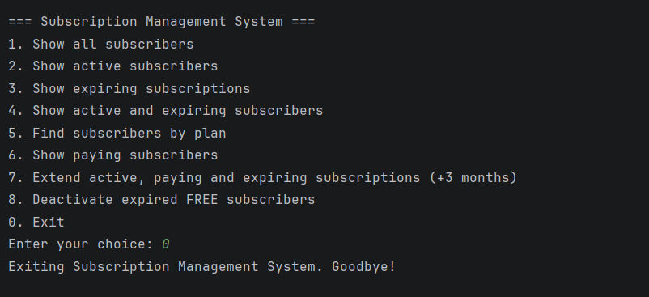

### 📋 Option 1 – Display All Subscribers

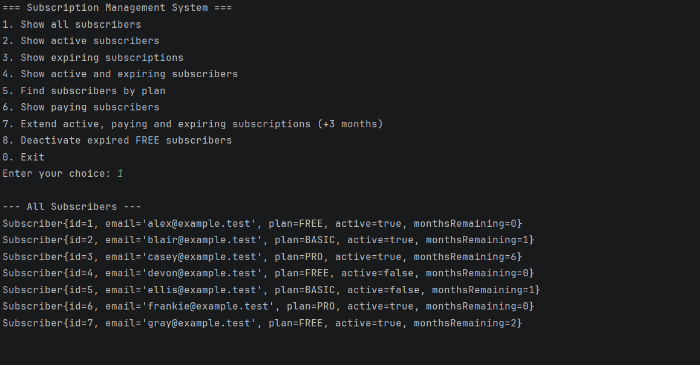

### 🟢 Option 2 – Display Active Subscribers

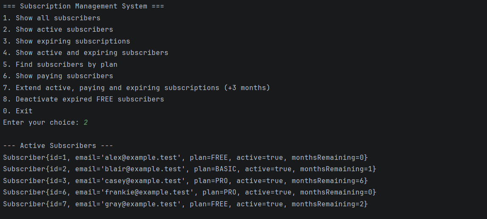

### ⏳ Option 3 – Display Expiring Subscribers

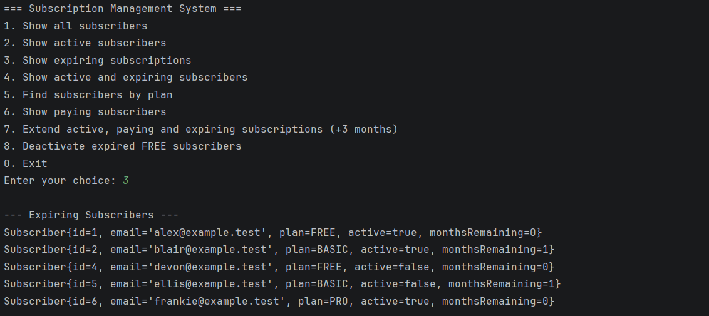

### 🔍 Option 4 – Display Active and Expiring Subscribers

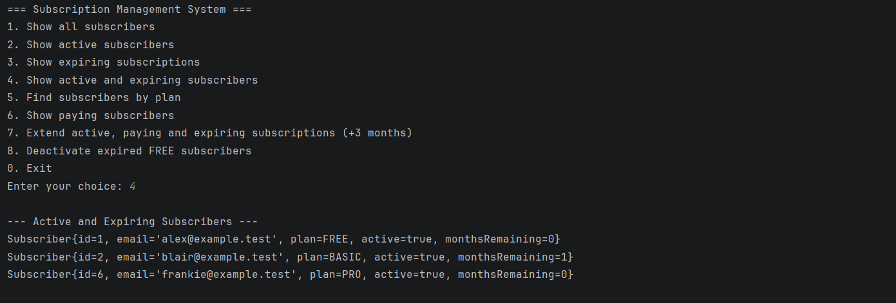

### 💳 Option 5 – Filter Subscribers by Plan

The console supports selecting FREE, BASIC and PRO plans.

**FREE plan:**


**BASIC plan:**

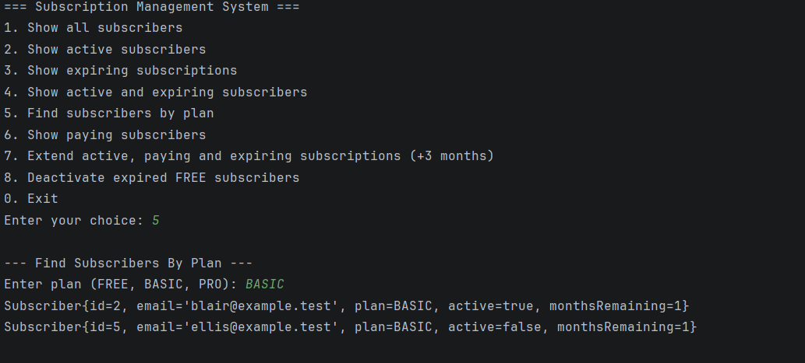

**PRO plan:**

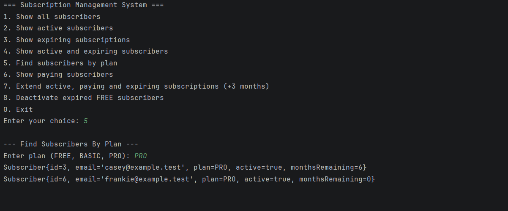

### 💰 Option 6 – Display Paying Subscribers


### 📅 Option 7 – Extend Eligible Subscriptions

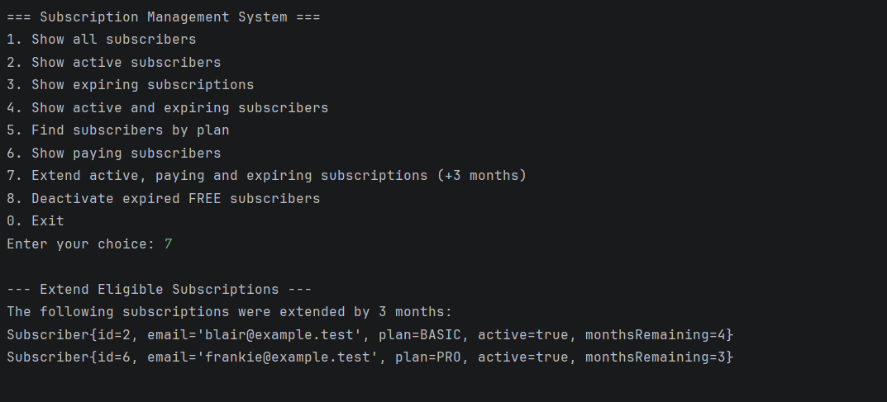

### 🚫 Option 8 – Deactivate Expired FREE Subscribers

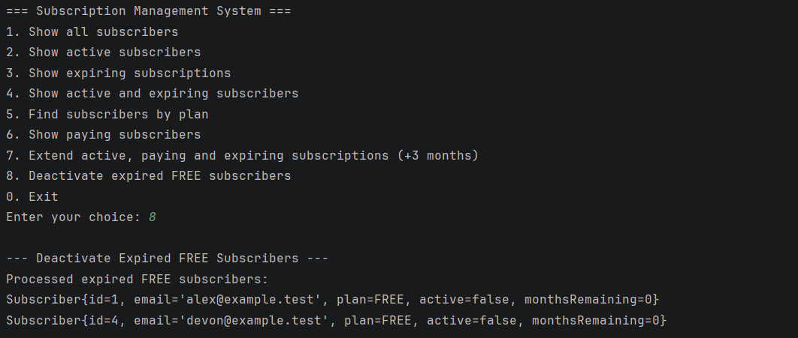

These screenshots document the manual console execution and the visible output for the corresponding menu options.

## 9.4 Testing Activities

The team performed the following testing activities:

- Unit testing of the Subscriber model.
- DAO operation testing.
- Functional filter testing.
- Subscription action testing.
- SubscriberProcessor testing.
- Six scenario-based integration tests.
- Edge-case and validation testing.
- Manual console acceptance checks.
- Automated build verification.

## 9.5 GitHub Actions

The final Java 25 verification was completed successfully through GitHub Actions.

**Workflow:** Java Build

[View GitHub Actions Run](https://github.com/jackaldzn-blip/functional-programming-workshop/actions/runs/43396578998)

**Verification command:**

```bash
mvn -B --no-transfer-progress clean verify
```

## 9.6 Issues Identified and Resolved

| Issue | Resolution | Status |
|---|---|---|
| Missing Subscriber toString() implementation | Added the override and corresponding model tests | ✅ Resolved |
| Duplicate model changes in initial Main work | Reconciled with the latest main branch | ✅ Resolved |
| Missing null validation in byPlan() | Added validation and unit test | ✅ Resolved |
| Processor action integration issue | Corrected processing logic to execute actions on matching subscribers | ✅ Resolved |
| Inconsistent sample subscriber data | Aligned components with the shared dataset | ✅ Resolved |
| Test package structure inconsistency | Aligned test packages with source packages | ✅ Resolved |
| Overlapping scenario test PRs | Consolidated scenario tests into assigned implementation PRs | ✅ Resolved |

---

# 10. ⚠️ Challenges and Resolutions

| Challenge | Action Taken | Outcome |
|---|---|---|
| Understanding the UML and component relationships | Team walkthrough and explanation of the UML | Shared understanding of responsibilities |
| Parallel development and integration | Separate branches and agreed API contracts | Reduced integration conflicts |
| Missing model functionality | Identified and added toString() | Improved console readability |
| Inconsistent sample data | Created a shared subscriber fixture | Consistent test expectations |
| Overlapping test contributions | Reviewed ownership and consolidated scenario tests | Reduced duplicate implementation |
| Processor integration | Collaborated on functional interface and action usage | Successful processing implementation |
| Final report coordination | Collected task information, PR references and member feedback | Consolidated completion report |

---

# 11. 📅 Project Collaboration and Meeting Summary

## 12 November 2026 – Initial Team Meeting

**Meeting Start:** 10:00 AM

### Discussion and Decisions

1. Anas created the GitHub repository and configured the Maven project structure.
2. Anas distributed the implementation tasks and defined individual responsibilities.
3. All team members were invited as repository collaborators.
4. Each member cloned the repository and reviewed the project structure and assigned tasks.
5. Tukue suggested starting with the Main class to ensure that changes could be compiled during development.
6. Tukue suggested implementing a console application.
7. Padma suggested reviewing the UML diagram before distributing implementation tasks.
8. Tukue explained the UML diagram to the team.
9. Padma suggested assigning clear ownership of the Main class and console application.
10. The team agreed that everyone could participate in reviewing pull requests.
11. Padma highlighted the importance of consistent branch naming conventions.
12. Anas started implementing the Subscriber model and Plan enum.

### Agreed Decisions

- Follow the UML structure.
- Use separate branches for individual tasks.
- Maintain clear task ownership.
- Allow all members to review pull requests.
- Implement an interactive console application.
- Begin integration as soon as the core model is available.

## 12 November 2026 – Follow-up Meeting

**Meeting Start:** Approximately 11:05 AM

### Progress and Discussion

- Anas completed the initial Subscriber and Plan implementation.
- Padma prepared shared subscriber data for testing.
- Padma identified that the Subscriber class needed a toString() override for readable console output.
- Padma communicated the issue to Anas.
- Anas added the required override and additional tests through PR #4.
- Padma continued preparing for the Main and console implementation.
- The team continued with individual component development and integration.

**Next Meeting:** 11:30 AM

---

# 12. 💡 Lessons Learned and Team Retrospective

This section consolidates the reflections and observations shared by team members during the workshop, including feedback from Anas, Jay and Carl, together with the team's collaboration experiences and Tukue's individual reflection.

## 12.1 ✅ What Went Well?

### 👥 Teamwork and Collaboration

- Tasks were distributed across all six members with clear component ownership.
- The team reviewed the UML diagram together before implementation.
- Members collaborated through GitHub branches and pull requests.
- Everyone was encouraged to review other members' code.
- Team members provided assistance when implementation or integration challenges occurred.
- Shared communication helped identify missing requirements and implementation issues.
- The team benefited from discussing different implementation approaches and reviewing each other's work.

### 💻 Technical Implementation

- Successfully implemented the required functional interfaces.
- Applied lambda expressions and method references.
- Used Java Streams to process subscriber collections.
- Developed reusable filtering and subscription action logic.
- Implemented all six workshop scenarios.
- Integrated the components into an interactive console application.

### 🧪 Testing and Quality

- Developed unit tests for individual components.
- Verified edge cases and validation rules.
- Used a shared sample dataset across the application.
- Performed integration testing.
- Used GitHub Actions to verify the complete application.
- Achieved 53 passing automated tests with zero failures.

### ⭐ Overall Positive Outcomes

The team gained practical experience in functional programming, modular development, GitHub collaboration, peer reviews and automated testing.

Reviewing different implementations and discussing alternative approaches helped members understand how individual components work together in a complete application.

## 12.2 🔧 What Could Be Improved?

### 📅 Planning and Task Coordination

- Review the UML and agree on API contracts before implementation begins.
- Define the implementation sequence and dependencies more clearly.
- Establish regular progress checkpoints to identify blockers earlier.
- Allocate sufficient time for integration and final testing.
- Consider different working speeds and availability when distributing tasks.

### 💬 Communication and Team Participation

- Provide more frequent updates on individual task progress.
- Ensure all members have enough time to understand their assigned tasks.
- Communicate blockers and dependencies as soon as they arise.
- Coordinate implementation timelines according to different working speeds and availability.
- Allow enough time for team discussions and knowledge sharing.

### 🔍 Code Reviews and Integration

- Begin integration testing earlier rather than waiting until all components are completed.
- Allow sufficient time for reviewing pull requests.
- Avoid overlapping implementation responsibilities.
- Keep shared test data and API contracts consistent.
- Document review feedback and resolutions.
- Ensure that all members understand the changes before integration.

### 📄 Documentation and Reporting

- Collect individual contributions immediately after task completion.
- Maintain testing evidence alongside implementation PRs.
- Include console demonstration evidence in the final documentation.
- Update project status continuously instead of waiting until the end.
- Maintain a central record of decisions and implementation changes.

### ⭐ Overall Improvement Area

The main improvement opportunity is better coordination between individual development activities and shared integration milestones.

Clearer communication, earlier integration and continuous documentation would make future workshops more efficient.

## 12.3 📚 Key Technical Learnings

Through this workshop, the team strengthened its understanding of the following Java concepts:

| Topic | Learning Outcome |
|---|---|
| Functional Interfaces | Creating interfaces that represent reusable behaviour |
| Lambda Expressions | Implementing behaviour with concise expressions |
| Method References | Reusing existing methods as functional implementations |
| Predicate | Defining reusable filtering conditions |
| Consumer | Executing operations on matching objects |
| Stream API | Processing collections using filter, map and other stream operations |
| Optional | Handling potentially missing subscriber records |
| Encapsulation | Protecting subscriber data through controlled access |
| Enum | Representing a fixed set of subscription plans |
| JUnit | Testing application behaviour and edge cases |

## 12.4 🤝 Key Teamwork Learnings

Collectively, the workshop highlighted the importance of:

1. **Clear Ownership:** Every member should understand their responsibilities and deliverables.
2. **Communication:** Regular updates help the team identify blockers and dependencies.
3. **Collaboration:** Team members should support one another when implementation challenges occur.
4. **Code Reviews:** Reviewing other members' code helps identify issues and share knowledge.
5. **Early Integration:** Integrating components regularly reduces last-minute issues.
6. **Testing:** Automated tests help maintain application stability.
7. **Documentation:** Recording decisions and contributions makes project reporting easier.
8. **Time Management:** Different working speeds and availability should be considered during planning.

## 12.5 🌟 Overall Team Reflection

The workshop was a valuable collaborative learning experience for Group 4.

The team learned that successful software development involves more than implementing assigned functionality. It also requires understanding the overall design, communicating effectively, reviewing each other's work, testing continuously and supporting the team throughout integration.

The reflections shared by the team highlighted the importance of functional programming concepts, reusable code, unit testing, API contracts, clear task ownership and effective communication.

The experience strengthened the team's technical knowledge of Java functional programming and improved practical skills in GitHub collaboration, code reviews, problem-solving and team coordination.

Overall, the workshop demonstrated how individual contributions, supported by continuous collaboration and testing, can come together to deliver a complete application.

---

# 13. 📦 Final Deliverables

| Deliverable | Description | Status |
|---|---|---|
| Source Code | Complete Java implementation | ✅ Completed |
| UML Diagram | Application class structure | ✅ Available |
| Subscriber Model | Subscriber and Plan | ✅ Completed |
| Data Access | SubscriberDAO implementation | ✅ Completed |
| Functional Filters | SubscriberFilter and SubscriberFilters | ✅ Completed |
| Functional Actions | SubscriberAction and SubscriberActions | ✅ Completed |
| Processor | SubscriberProcessor implementation | ✅ Completed |
| Console Application | Interactive Main class | ✅ Completed |
| JUnit Tests | Unit and scenario tests | ✅ Completed |
| JUnit Evidence | Individual and complete test screenshots | ✅ Collected |
| Console Evidence | Screenshots covering menu options and plan selections | ✅ Collected |
| README.md | Project overview and instructions | ✅ Available |
| GitHub Actions | Automated build and verification | ✅ Successful |
| Project Report | Summary and completion report | 📝 Prepared |

## 13.1 📁 Evidence Folder Structure

The testing evidence is maintained inside the repository under `docs/evidences/images/`.

```text
docs/
├── evidences/
│   └── images/
│       ├── console/
│       │   ├── console-0.png
│       │   ├── console-1.png
│       │   ├── console-2.png
│       │   ├── console-3.png
│       │   ├── console-4.png
│       │   ├── console-5Basic.png
│       │   ├── console-5Free.png
│       │   ├── console-5PRO.png
│       │   ├── console-6.png
│       │   ├── console-7.png
│       │   └── console-8.png
│       └── junit/
│           ├── sunscribermodel.png
│           ├── JunitRun.png
│           ├── PlanScenario.png
│           ├── SubscriberActions.png
│           ├── SubscriberDAO.png
│           └── SubscriberFilters.png
└── final-report.md
```

The report uses relative image paths so that screenshots can be displayed directly on GitHub when the report and evidence folders are committed to the repository.

## 13.2 How to Build and Run the Application

**Prerequisites:**

- JDK 25
- Maven

### Build and Test

```bash
mvn clean verify
```

### Run the Application

```bash
mvn exec:java
```

The application is configured to run through the Maven Exec plugin using `com.workshop.Main`.

---

# 14. 🏁 Project Completion Status

## 14.1 Completion Checklist

- [x] Requirements reviewed.
- [x] UML diagram reviewed.
- [x] Team responsibilities distributed.
- [x] Shared API contracts established.
- [x] Subscriber model implemented.
- [x] SubscriberDAO implemented.
- [x] Functional interfaces implemented.
- [x] Filtering rules implemented.
- [x] Subscription actions implemented.
- [x] SubscriberProcessor implemented.
- [x] All six scenarios implemented.
- [x] Interactive console application completed.
- [x] Unit and integration testing completed.
- [x] Complete 53-test execution verified.
- [x] Individual JUnit evidence collected.
- [x] Console evidence collected for options 0–8.
- [x] Plan selection evidence collected for FREE, BASIC and PRO.
- [x] GitHub Actions verification passed.
- [x] Documentation prepared.
- [x] Individual contribution summaries consolidated.
- [x] Tukue's contribution and lessons learned included.
- [x] Pull request register updated, including PR #22's closed status.
- [x] Final member evidence consolidated.
- [x] Final Team Lead approval (PR #21).

---

# 15. 🎓 Final Conclusion

Group 4 successfully completed the Subscription List Management System using Java functional programming concepts.

The team translated the provided UML design into a working application and implemented the required subscriber management, filtering, processing and subscription action functionalities.

All six workshop scenarios were completed, and an interactive console application was developed to demonstrate the integrated functionality.

The project successfully passed all 53 automated JUnit tests through GitHub Actions, with zero failures, errors or skipped tests.

Individual JUnit evidence and manual console screenshots were also collected to demonstrate the implementation and execution of the application.

Beyond the technical implementation, the workshop provided valuable experience in collaborative development, task allocation, GitHub workflows, pull-request reviews, integration testing and documentation.

Each member contributed to the project through individual implementation and testing responsibilities. The team's collaboration helped bring the separate components together into a complete application.

**Overall, Group 4 achieved the technical objectives of the workshop and delivered a successfully tested Java application. The project also provided valuable lessons in communication, coordination, code quality and teamwork that can be applied to future software development projects.**

---

# 16. 🔗 Repository References

The following repository documents provide additional information about the project design, responsibilities and implementation.

### 📁 Main Project Documentation

- [Project Repository](https://github.com/jackaldzn-blip/functional-programming-workshop)
- [README.md](../README.md)
- [TEAM.md](../TEAM.md)
- [Team Implementation Tasks](team-tasks.md)
- [Technical UML](technical-uml.md)
- [API Contracts](contracts.md)
- [Testing Responsibilities](testing-responsibilities.md)
- [Example Scenarios](example-scenarios.md)
- [Workshop Coverage](workshop-coverage.md)
- [Final Report Template](final-report-template.md)

### 👥 Individual Task Documents

- [Member 1 – Anas](member-tasks/member-01-model-lead.md)
- [Member 2 – Veselina](member-tasks/member-02-dao.md)
- [Member 3 – Jay](member-tasks/member-03-filters.md)
- [Member 4 – Tukue](member-tasks/member-04-actions.md)
- [Member 5 – Carl](member-tasks/member-05-processor.md)
- [Member 6 – Padma](member-tasks/member-06-main-report.md)

### 🔍 Pull Request History

[View All Pull Requests](https://github.com/jackaldzn-blip/functional-programming-workshop/pulls?q=is%3Apr)

### ⚙️ Automated Test Results

[View GitHub Actions](https://github.com/jackaldzn-blip/functional-programming-workshop/actions)

---

## 📝 Report Information

| Field | Details |
|---|---|
| Prepared By | Padma |
| Group | 4 |
| Team Lead | Anas |
| Submission Date | 13-11-2026 |
| Report Version | 1.0 |
| Project | Functional Programming |
| Implementation Status | Completed |
| Report Approval | Approved by Team Lead (PR #21) |

---

# 🎉 END OF GROUP 4 PROJECT COMPLETION REPORT
