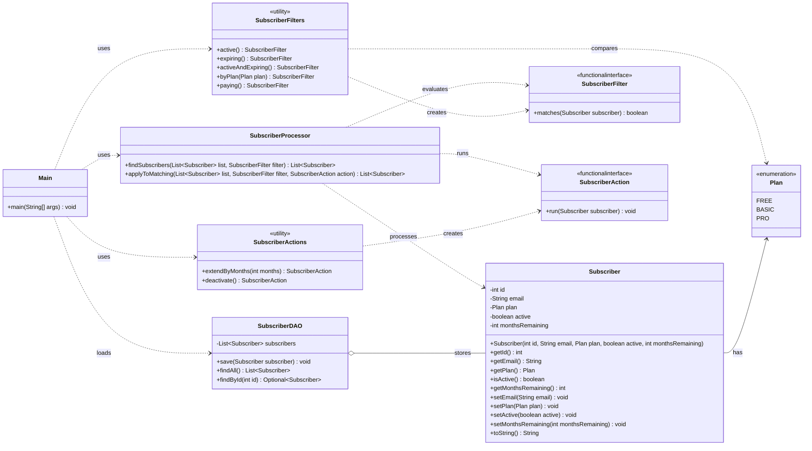

# Technical UML — Markdown Mermaid diagram

This Mermaid diagram shows the workshop's six conceptual types—`Subscriber`, `Plan`, `SubscriberDAO`, `SubscriberFilter`, `SubscriberAction` and `SubscriberProcessor`—alongside the team's supporting helpers and entry point. The additional elements are implementation choices, not extra instructor requirements.

**Implementation note (12 November 2026):** the core components below are merged. The `Main` dependency arrows describe the **intended completed console design**; the current `Main.java` still prints sample data without invoking the full interactive workflow. See [project status](project-status.md). The optional `SubscriberActions.activate()` helper is implemented but not drawn as an original workshop rule.

## Member-to-class assignment

| Member | Diagram elements |
|---|---|
| 1 | `Plan`, `Subscriber` |
| 2 | `SubscriberDAO` |
| 3 | `SubscriberFilter`, `SubscriberFilters` |
| 4 | `SubscriberAction`, `SubscriberActions` |
| 5 | `SubscriberProcessor`; processor unit tests and scenario 3 |
| 6 | `Main`; `PlanScenarioTest` (test class not shown); shared report coordination |

**Design note:** The workshop leaves the contents of the `applyToMatching` result unspecified; the team returns the matched, processed subscribers. The `Subscriber.toString()` override supports readable output. See [contracts.md](contracts.md) for the agreed API.
